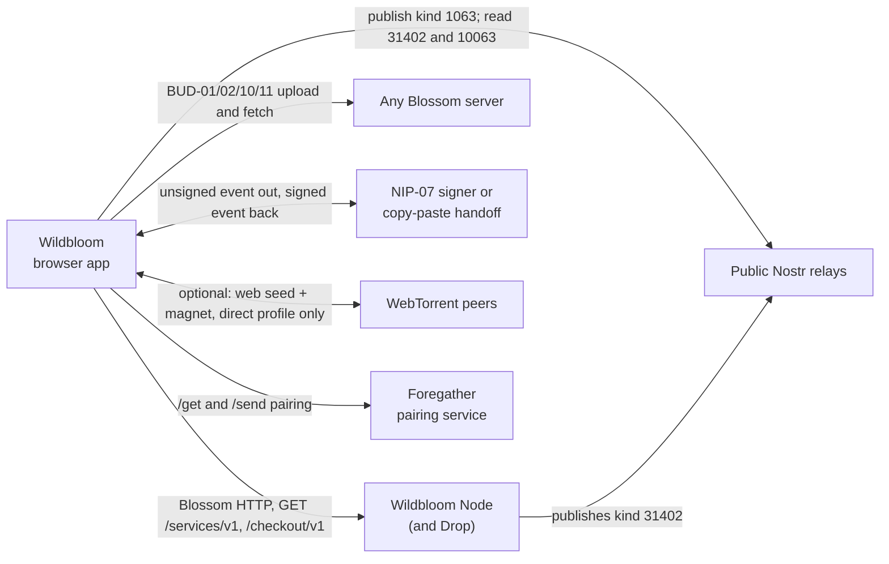

# Where Wildbloom fits

Wildbloom is a local-first browser application, written in TypeScript, that publishes and retrieves one file through three existing protocols: Nostr for signed discovery, Blossom for content-addressed HTTP delivery and, optionally, WebTorrent for peer delivery. It allocates no storage and runs no storage network; every neighbour below is something it talks to over a standard protocol, not something it links against. Internals are in [ARCHITECTURE.md](ARCHITECTURE.md).

| Neighbour | Relationship | Interface | Status |
| --- | --- | --- | --- |
| Wildbloom Node | Companion storage node; no code dependency in either direction | Kind 31402 (`forgesworn-storage-service-v1`) read from the user's relays, then one unsigned `GET /services/v1` that must match the signed service key, listing and origin; plain Blossom HTTP; `/checkout/v1/*` under NIP-98 (kind 27235); direct send `wildbloom-direct/1` from `/send` to Drop, with the node repo's test vectors copied unedited (`test-vectors/wildbloom-direct-v1.json`) | Built; node services are opt-in on the node. The app never calls `PUT /mirror` |
| Any Blossom server | Holds the encrypted envelope | BUD-01 retrieval, BUD-02 upload, BUD-10 references, BUD-11 kind 24242 authorisation; BUD-03 kind 10063 lists for trusted-server discovery | Built |
| Public Nostr relays | Where file events are published and looked up | NIP-94 kind 1063, plus NIP-35 kind 2003 when trackers are set; lookups of kinds 31402 and 10063 on at most eight relays the user configured | Built; each is a separate user action |
| NIP-07 signer or copy-paste handoff | Signs every event, so no private key enters the app | Injected `window.nostr`, or canonical event JSON copied out and a signed event pasted back. The app never contacts the signer | Built |
| WebTorrent peers | Optional peer delivery | `webtorrent` 3.0.21, with the Blossom URL as a web seed and a magnet URI in the kind 1063 event. Direct profile only; no implicit STUN or TURN; Tor-only mode refuses it | Built; optional |
| Foregather pairing service | Word-verified exchange behind the `/get` recipient page and the `/send` page | `@forgesworn/foregather-kit` 0.6.0. The service origin is fixed at build time (default `https://shelter.forgesworn.dev/pair/v1/`, override `VITE_WILDBLOOM_PAIR_RELAY`) and never read from a link | Built |

Three ForgeSworn packages do specific work here:

- `402-announce` 2.3.0: validates kind 31402 events against the storage-service schema, picks the latest valid event per service key and listing, and checks the endpoint binding (`src/core/storage-discovery.ts`). The relay query and the `/services/v1` request are Wildbloom's own.
- `farrier-kit` 1.1.3: `farrier-kit/bolt11` decodes a Lightning invoice's amount, network, timestamp and expiry so the page can compare them with the quote (`src/core/checkout.ts`). Signature validation is the node's job and the wallet checks the request itself.
- `@forgesworn/foregather-kit` 0.6.0: the pairing flow, pairing-link parsing and live relay client in `src/get/main.ts` and `src/send/main.ts`.

## What this repo leaves to others

- Storing bytes: Blossom servers and Wildbloom Node. ForgeSworn provides the software and the static client and does not operate a storage service or marketplace.
- Mirroring and repair between nodes (BUD-04): Wildbloom Node.
- Key custody and the recovery key: the user's signer and the user. The recovery key never enters Blossom, Nostr, a torrent or browser storage.
- Money: the operator's invoice or LNURLcash issuer and the user's wallet. The page checks quote and invoice fields and never moves funds.
- Relay, tracker and STUN or TURN availability: whatever the user or the build configures. The `/send` ICE servers come only from the authenticated invitation and a build-time allowlist.
- Running the pairing service: not this repo. It holds only the origin.

## Not built yet

- Live wallet and issuer acceptance for paid storage on a real Wildbloom Node.
- Direct send from Drop to the page (`from-drop`). The protocol reserves it; `/send` implements `to-drop` only.
- A completed physical-device packet-evidence run for cross-device peer delivery (README, "Current status").
- Browser use of BUD-04 mirroring. Wildbloom Node performs it; the app does not.

Checked against wildbloom ee21ed5, wildbloom-node eb482b6, 402-announce 2.3.0, farrier-kit 1.1.3 and foregather-kit 0.6.0 on 6 November 2026.
